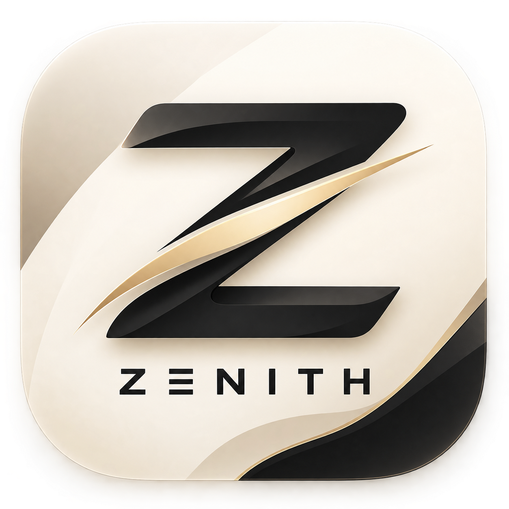

  

<h1 align="center">ZENITH</h1>

  <strong>Minimalist Media Downloader for Android/Ios and windows</strong>

  Simple. Fast. Clean. No Ads.

  A lightweight media downloader built to keep downloading simple.

  
  

  
  

  About

ZENITH is a minimalist media downloader for Android designed for users who want a simple and clean way to process media links from multiple popular platforms.

Instead of filling the interface with unnecessary features, ZENITH focuses on what matters:

Paste a link. Process it. Download your media. Done.

The application is designed to be lightweight, straightforward, and free from advertisements.

«No clutter. No unnecessary features. Just a simple media downloading experience.»

---

Why ZENITH?

There are many media downloader applications available, but many of them come with complicated interfaces, excessive advertisements, or unnecessary features.

ZENITH takes a different approach.

Built Around Simplicity

The interface is intentionally minimal so users can immediately understand what to do without navigating through complicated menus.

Built for Multiple Platforms

Instead of switching between different tools for different platforms, ZENITH brings supported platforms together into one application.

Built Without Advertisements

ZENITH does not display banner ads, pop-ups, or interstitial advertisements during normal use.

---

Advantage

<table>
<tr>
<td width="50%">Minimalist UI

A clean interface designed to keep the application easy to understand and comfortable to use.

</td>
<td width="50%">Multi-Platform

Process media links from multiple popular platforms through a single application.

</td>
</tr><tr>
<td width="50%">Download History

Keep track of previously processed downloads directly inside ZENITH.

</td>
<td width="50%">No Ads

No banner advertisements, pop-ups, or intrusive advertising during normal usage.

</td>
</tr><tr>
<td width="50%">Lightweight

A simple application focused on its primary purpose without unnecessary features.

</td>
<td width="50%">Automated Builds

Official APK releases can be generated through automated GitHub Actions workflows.

</td>
</tr>
</table>---

## 🌐 Supported Platforms & Scraper Engines

| Platform                                                                               | Supported Domains / Formats                                    | Features                     | Scraper Engine / Provider                                                               |
| :------------------------------------------------------------------------------------- | :------------------------------------------------------------- | :--------------------------- | :-------------------------------------------------------------------------------------- |
|  **Instagram**    | `instagram.com` (`/p/`, `/reel/`, `/stories/`)                 | Reels / Stories / Photos     | **InDown** (`indown.net`) & **SnapSave** (`snapsave.app`)                               |
|  **TikTok**          | `tiktok.com`, `vt.tiktok.com`                                  | Video (No WM) / Slide Photos | **TikDownloader** (`tikdownloader.io`) & **TikTokIO** (`tiktokio.com`)                  |
|  **YouTube**        | `youtube.com`, `youtu.be`, `music.youtube.com`                 | Playlist / Album / MP4 / MP3 | **Ytmp3.gg** (`media.ytmp3.gg`) & **Ytmp3.mobi** (`ytmp3.mobi`)                         |
|  **Twitter (X)**          | `twitter.com`, `x.com`                                         | HD Video / GIFs              | **TwitterVideoDownloader** (`twittervideodownloader.com`) & **SaveTWT** (`savetwt.com`) |
|  **Spotify**        | `open.spotify.com` (`track`, `album`, `playlist`, `/s/`)       | Playlist / Album / MP3       | **SpotiDown** (`spotidown.app`) & **SoundLoaders** (`spotimate.app`)                    |
|  **Apple Music** | `music.apple.com`                                              | Album / Playlist / MP3 Track | **AplMate** (`aplmate.com`)                                                             |
|  **Pinterest**    | `pinterest.com`, `pin.it`                                      | Video / HD Images            | Direct `pinimg.com` Parser & **PinDown** (`pindown.io`)                                 |
|  **Facebook**      | `facebook.com`, `fb.watch`                                     | Reels / HD Video             | **SnapSave** (`snapsave.app`)                                                           |
|  **RedNote**    | `xiaohongshu.com`, `xhslink.com`, `xhslink.cn`, `rednote.com`  | HD Photos / Videos           | Direct `__INITIAL_STATE__` SSR Extractor                                                |
|  **Threads**        | `threads.com`                                                  | Video / Photo Carousel       | **Threadster** (`threadster.app`)                                                       |
|  **Bilibili**      | `bilibili.com`, `b23.tv`, `bili.im`, `bilibili.tv`             | Video / Audio (DASH 1080p)   | Direct Bilibili Web API (`api.bilibili.com` & `api.bilibili.tv`) & Wbi Resolver         |
|  **Pixiv**            | `pixiv.net` (`artworks`)                                       | Gallery / Ugoira to MP4      | Direct Pixiv AJAX API & Ugoira Zip-to-MP4 Converter                                     |
|  **Douyin**          | `douyin.com`, `v.douyin.com`                                   | Video (No WM) / Photos       | Direct `iesdouyin.com` API & Multi-Marker SSR Resolver                                  |
|  **Bandcamp**      | `*.bandcamp.com`                                               | Track / Album / MP3          | **BandcampDownloader** (`bandcampdownloader.app`)                                       |
|  **Reddit**          | `reddit.com`, `redd.it`                                        | HD Video (Audio) / Photos    | **RapidSave** (`rapidsave.com`)                                                         |
|  **TeraBox**            | `terabox.com`, `teraboxapp.com`, `1024tera.com`, `teraboxlink` | Direct File / Stream (m3u8)  | **Sechno** (`sechno.com`)                                                               |

«Platform support depends on the current implementation and may change when third-party services modify their systems, APIs, URLs, authentication, or content delivery mechanisms.»

---

Download History

ZENITH includes a built-in Download History system.

Every supported download can be tracked through the application's history interface, making it easier to find previously processed media without manually searching through your device.

---

No Ads

One of the core ideas behind ZENITH is a clean user experience.

ZENITH does not intentionally display advertisements inside the application.

There are no:

- Banner advertisements
- Pop-up advertisements
- Full-screen advertisements
- Interstitial advertisements
- Advertising overlays

The application remains focused on its primary functionality instead of filling the interface with advertisements.

---

## Security & Safety Notice

Zenith is **100% open-source, ad-free, and contains zero malware, spyware, or trackers**. All network requests and file downloads run locally on your device without external analytics servers.

> [!TIP]
> **Doubtful or concerned about false-positive security warnings?**
> Because Zenith release binaries (`.apk`, `.ipa`, and `.exe`) are open-source builds compiled without expensive commercial enterprise signing certificates, some OS security software or browsers may display standard false-positive warnings.
>
> If you have any doubts, you can upload and scan any release file directly on **[VirusTotal](https://www.virustotal.com/)** before installing!

> [!NOTE]
> **Android Play Protect Warning:**
> When installing the `.apk` manually (sideloading outside Google Play Store), Play Protect may display a security prompt.
>
> Tap **"More Details"** → **"Install Anyway"** if you trust the source of the APK.

> [!NOTE]
> **iOS IPA Installation Warning:**
> When installing the `.ipa` manually outside the App Store, iOS may require the application to be signed with a valid Apple certificate or installed through a supported sideloading method.
>
> If iOS displays a warning or refuses to open the application, verify that the IPA was obtained from a trusted source and that it has been properly signed before installation.

> [!NOTE]
> **Windows Security Warning:**
> When running or installing the `.exe` manually, Windows Defender SmartScreen may display a security warning if the application is not signed with a trusted commercial code-signing certificate.
>
> If Windows displays a warning, verify that the `.exe` was downloaded from the official ZENITH repository before continuing.

## Installation

### Android

**Download**

Download the latest official APK from the project's GitHub Releases page.

**Verify**

Make sure the APK was downloaded from the official ZENITH repository or another officially provided distribution channel.

**Install**

Open the APK on your Android device and follow the Android installation instructions.

If Android asks for permission to install applications from that source, review the source carefully before continuing.

### iOS

**Download**

Download the latest official IPA from the project's GitHub Releases page.

**Verify**

Make sure the IPA was downloaded from the official ZENITH repository or another officially provided distribution channel.

**Install**

Install the IPA on your iOS device using a supported sideloading method and follow the installation instructions.

If iOS displays a warning or refuses to open the application, verify that the IPA is properly signed and was obtained from a trusted source.

### Windows

**Download**

Download the latest official Windows `.exe` from the project's GitHub Releases page.

**Verify**

Make sure the `.exe` was downloaded from the official ZENITH repository or another officially provided distribution channel.

**Install**

Open the `.exe` on your Windows device and follow the Windows installation instructions.

If Windows Defender SmartScreen displays a security warning, review the file source carefully before continuing.

## Screenshot

  
  
  

  
  
  

## 📜 Features

- **16 Platforms in One App**: Save watermark-free videos, high-resolution photos, and audio from TikTok, Instagram, YouTube, Twitter/X, Spotify, Apple Music, Pinterest, Facebook, Threads, Bandcamp, Pixiv, Bilibili, Douyin, RedNote, Reddit, and TeraBox.
- **Over-The-Air (OTA) Scraper Hot-Patching**: Never wait for app updates when a platform changes its API. Mori seamlessly hot-patches scraper engines in the background without needing to reinstall the app.
- **Custom Directory & Storage Freedom**: Pick any folder across your device storage (including SD cards, Movies, Downloads, and custom folders) with native folder pickers and full file management support.
- **One-Tap Playlists & Albums**: Download full music albums or playlists from **Spotify**, **Apple Music**, and **YouTube** in one click instead of saving songs one by one.
- **High-Speed Concurrent Downloads**: Download music albums, playlists, and multi-photo galleries in parallel with up to 5 concurrent worker threads for blazing fast speeds.
- **Floating Download Bubble & Manager**: Non-intrusive monochrome floating bubble tracking active tasks in real-time with an aggregated progress ring, expandable dropup tray, individual task progress bars, and instant cancellation.
- **Quick Save via Android Share Menu**: Spot a video you love? Tap **Share** in any app and select Mori to download it instantly in a neat overlay without switching apps.
- **Multi-Link Batch Mode**: Paste several links at once and let Mori queue and download them all automatically in the background.
- **Built-in Custom Fullscreen Player & Preview**: Play videos, stream tracks, and browse photo carousels right inside the app with a sleek custom fullscreen player, real-time title bar, smooth seek scrubbing, double-tap seek, and mute controls.
- **Integrated Media Gallery**: Browse and play all saved videos, music, photos, and PDF documents directly within the app, complete with media filter chips, real-time search, sorting options, and an in-app viewer.
- **Instant Photo-to-PDF**: Combine photo galleries or multi-image posts into a single, clean PDF file for offline reading or sharing.
- **PIN & Biometric Lock**: Protect your download history, media gallery, and settings with an optional 4-digit PIN code or fingerprint / Face ID lock.
- **Clean Folder Organization**: Files are neatly organized in standard system folders (`Movies/Mori`, `Music/Mori`, `Pictures/Mori`) for easy access in your gallery.
- **Automatic Clipboard Detection**: Opening Mori automatically suggests your copied link for instant one-tap downloading.
- **Background Downloads**: Large videos and playlists keep downloading seamlessly even when you minimize the app or turn off the screen.
- **Anti-Corrupt File Protection**: Files are saved securely—media only appears in your gallery once 100% complete, preventing broken or unplayable files.
- **Modern Themes & Live Backgrounds**: Choose from elegant dark modes and interactive animated backgrounds (Stars, Waves, Fireflies).
- **9 Languages**: English, Indonesian, Japanese, Korean, Simplified Chinese, Arabic (with RTL support), Russian, Tagalog, and Hindi.
- **100% Private & Ad-Free**: No ads, no analytics, no accounts required, and zero external hosting. Everything runs on your device.

Usage

1. Open ZENITH
2. Copy a supported media URL
3. Paste the URL into ZENITH
4. Process the URL
5. Select an available media option
6. Start the download
7. Find previous downloads in Download History

---

Disclaimer

ZENITH is an independent third-party application.

It is not affiliated with, endorsed by, sponsored by, or officially supported by TikTok, Instagram, YouTube, X / Twitter, Spotify, Bilibili, Douyin, RedNote, Threads, Pinterest, Apple Music, Facebook, Bandcamp, Pixiv, or their respective owners.

All trademarks, logos, and brand names belong to their respective owners.

Third-party platforms may change their systems or policies at any time, which may affect ZENITH's compatibility.

---

License

This project is distributed under the license specified in the repository's "LICENSE" file.

Please read the license before using, modifying, or redistributing the source code.

---

## Official Download

Download the latest official APK from the
[Releases](https://github.com/dirrzzx948-png/Zenith/releases/tag/v4.4.0) page.

> Avoid downloading modified or repackaged versions from unofficial sources.
  
## Technology

ZENITH is built with web technologies and
[Capacitor](https://capacitorjs.com/) for Android.

  </a>

